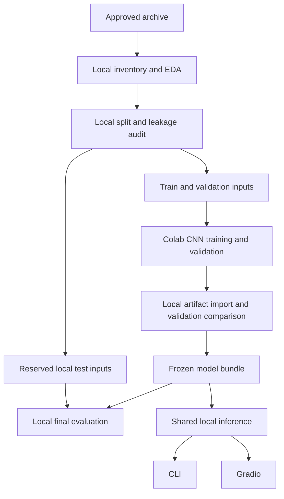

# Technical Requirements Document

**Project** · Rock–Paper–Scissors Image Classification using CNN  
**Phase** · 0 — Requirements  
**Status** · Draft for team review  
**Product specification** · [PRD](01_PRD.md)

## 1. Technical overview and objectives

Use a single Python codebase for data curation, CNN construction, training, evaluation, and serving. Keep portable data assignments and model input contracts so a Colab-trained model can be evaluated and served locally. The design below is preliminary unless marked as approved. Final architecture, dataset specifics, experiment protocols, milestones, and individual test cases belong in later phases.

## 2. Technology stack and rationale

| Approved choice | Role and rationale |
| --- | --- |
| Python 3.13 and TensorFlow/Keras | Shared model, tensor, training, and serialization APIs for both environments. Verify and pin a compatible package combination before the first run. |
| Local VS Code, Jupyter, and Python modules | Develop and test reusable functions locally. Use notebooks to explain EDA, model behavior, and results. |
| Google Colab | Execute all full epoch-based training, validation during training, and training experiments. Prefer a GPU when available. |
| Git and GitHub | Record code, configuration, and document revisions. Store bulk data and generated model artifacts separately with recorded identifiers and checksums. |
| `.keras`, configuration files, CSV, JSON, and Markdown | Persist reloadable models, machine-readable run records, and human-readable findings with versionable formats. |
| Pytest, CLI, and Gradio | Verify core behavior automatically and expose the same local prediction logic through two lightweight interfaces. |

## 3. Architecture and data flow



The split manifest, source revision, and resolved configuration define the training inputs. The signed-off selection record identifies the exact artifact approved for final evaluation. Test image bytes and labels remain local throughout development.

## 4. Proposed directory structure

```text
docs/                       Requirements and later decisions
notebooks/                  EDA, Colab training entry point, and evaluation analysis
src/rps/                    Importable Python package
  dataset.py                Inventory and split assignments
  preprocessing.py          Shared deterministic image processing and training input pipeline
  model.py                  Custom CNN construction
  train.py                  Training and validation orchestration
  evaluate.py               Metrics, comparisons, and final evaluation
  artifacts.py              Bundle and metadata read/write
  inference.py              Local model loading and prediction
  cli.py                    Command-line entry point
  app.py                    Gradio entry point
configs/                    Versioned defaults and experiment overrides
tests/                      Pytest suite
data/                       Local raw data and derived manifests
artifacts/                  Run bundles, evaluation outputs, and selected model
```

Paths and module boundaries are proposals. Use Git for source, configs, and small reproducibility records suitable for sharing. Keep dataset files, bulk artifacts, and credentials outside tracked content.

## 5. Component responsibilities and dependencies

| Component | Responsibilities and inputs |
| --- | --- |
| Dataset preparation | Inventory the approved archive, resolve anomalies, identify groups, and produce versioned assignments for downstream consumers. |
| Preprocessing | Decode or normalize the image representation, resize, and scale pixels through shared deterministic operations. Build training batches with optional training-only transformations. |
| Model and training | Construct the configured CNN, consume train and validation datasets, and export selected checkpoints and epoch records. |
| Evaluation | Consume frozen assignments, class mapping, and model artifacts. Produce metrics in a fixed label order and link diagnostics to the evaluated artifact. |
| Artifact I/O and inference | Verify the bundle, load the model, check input and output contracts, and expose a single-image predictor to the CLI and Gradio. |

Notebook cells call the modules so training and evaluation share their preprocessing and label logic. The inference path has no dependency on the training notebook or Gradio.

## 6. Dataset acquisition and validation

Acquire the approved archive locally when the dataset phase begins. Record publisher, Kaggle release identifier where available, retrieval date, license, original filename, and archive SHA-256. Preserve the raw archive and record every curation decision separately. The published target is 2,188 photographs in the three classes. Confirm source PNG format, RGB mode, 300 × 200 pixel dimensions in width × height order, class folders, and count before accepting the manifest. [Kaggle dataset](https://www.kaggle.com/datasets/drgfreeman/rockpaperscissors) · [Dataset creator’s overview](https://github.com/DrGFreeman/rps-cv-data-science#dataset)

Inventory relative paths, class labels, file hashes, decoded pixel hashes, dimensions, and any reliable capture metadata. Check decodability, unexpected files, missing or conflicting labels, and metadata anomalies. Record exclusions and unresolved discrepancies. Confirm per-class counts from the validated archive and avoid using published totals as split inputs. Retain attribution and document how dataset material is used in reports and shared artifacts.

## 7. Exploratory data analysis

Use a local notebook to report class counts, shape and color-channel distributions, corrupt files, exact and likely duplicate counts, and the availability of grouping metadata. Review representative images for hand framing, lighting, background consistency, ambiguous gestures, and label quality. Before splitting, use dataset-wide inspection for validation and group discovery. After splitting, perform model-facing visual exploration and preprocessing decisions on training data, with validation used for the defined comparisons. Reserve test examples for final error analysis after the selection freezes.

## 8. Dataset splitting, preprocessing, and augmentation

- **Split.** Form groups from confirmed near duplicates, identical decoded images, and trusted capture-session relationships. Merge overlapping relationships before assignment. Aim for 70:15:15 using class-aware group allocation with a recorded seed and stable inventory ordering. Preserve group integrity and class coverage if the ratio needs to move. Report achieved counts by class and split. If a group-preserving split cannot cover all classes, pause for team review before training.
- **Deterministic processing.** Standardize decoded images to RGB, use a documented resizing method that preserves the gesture, and apply a fixed pixel conversion. A provisional baseline uses aspect-ratio-preserving resize with padding and float32 scaling from 0–255 to 0–1. Freeze the dimensions, interpolation, padding, scaling, and ownership in the bundle contract. Route each input through the conversion once.
- **Augmentation.** Start with an unaugmented baseline. For controlled comparisons, consider modest translations, zoom, rotation, brightness variation, and horizontal flip if previewed examples preserve their labels and framing. Keep random transformations in the training input pipeline and apply deterministic preprocessing to validation, test, and inference. Exact transformations and ranges are pending. [TensorFlow data augmentation](https://www.tensorflow.org/tutorials/images/data_augmentation)

## 9. Preliminary CNN architecture

The baseline takes a fixed-size RGB tensor, uses a small stack of convolution and ReLU blocks with spatial pooling, and ends in a compact feature-to-class head with three softmax outputs. Convolutions learn local visual features and pooling reduces spatial resolution and computation. Use a flatten-and-small-dense head as a provisional reference so a later global average pooling experiment can show the trade-off between retained spatial features and parameter count. Verify that the baseline capacity fits the dataset and Colab budget. Input shape, number of blocks, widths, kernels, and head size remain provisional. Use explicit integer labels and sparse categorical cross-entropy as the initial loss proposal.

## 10. Training and validation methodology

Build datasets from explicit manifest assignments. Shuffle training examples reproducibly and preserve evaluation ordering for label and prediction alignment. Use Adam as a provisional starting optimizer. Record epoch-level training and validation loss and accuracy as well as validation macro F1 computed over the full validation split using a fixed three-class order. Save the checkpoint with the best validation macro F1 under a deterministic within-run tie rule. Treat the epoch budget, early stopping policy, batch size, and learning rate as run settings to settle before each comparison. Record interrupted runs and whether any run resumed from a checkpoint.

## 11. Local VS Code and Google Colab workflow

1. Locally validate the data, freeze the reviewed split, and develop modules and configurations in VS Code. Use Pytest and small forward-pass or serialization checks for local verification.
2. In Colab, obtain the exact local code revision, resolved config, and train and validation subset. Verify artifact identities and the runtime against the run specification before enabling training. Record the assigned accelerator and use a Colab CPU run only if the experiment is feasible there.
3. Execute full training and training-time validation in Colab using the shared code. Preserve checkpoints and histories outside ephemeral runtime storage as they are produced.
4. Export the selected checkpoint, final model, and run records to local storage. Verify them before comparing candidates, running final evaluation, or enabling inference.

## 12. Model and artifact portability

Each completed run has a uniquely identified bundle with `.keras` artifacts, CSV epoch history, resolved configuration, JSON class mapping and run metadata, and a manifest of file roles and checksums. The manifest identifies the recommended checkpoint and records its source revision, dataset and split identities, preprocessing contract, input tensor specification, and output class order. The separate class mapping associates every output index with one display label. Record compatible Python and TensorFlow/Keras versions for Colab and local CPU. Favor serializable built-in layers and verify deserialization and prediction agreement on a fixed validation sample within a documented tolerance. Preserve failed exports as incomplete and keep prior verified bundles available. [TensorFlow model saving and loading](https://www.tensorflow.org/tutorials/keras/save_and_load)

## 13. Evaluation and selection criteria

Select across comparable runs using the highest validation macro F1, calculated as the unweighted mean of the three class F1 scores. As a provisional tie rule, prefer fewer parameters when scores are tied at a predeclared comparison precision, then use a stable run identifier. Record the rule and precision before comparison. Keep a signed-off selection record with the model, class order, preprocessing contract, and split identity before opening the test split.

Use the frozen candidate for final evaluation. Report test accuracy, macro precision and recall, macro F1, per-class precision, recall, F1 and support, and a confusion matrix with labeled axes. Document zero-division handling. Include training and validation learning curves and representative test errors with plausible explanations grounded in the images. Report total parameter count, bytes of the evaluated `.keras` file, and single-image latency with hardware, warm-up, sample count, and timing boundaries. A provisional latency boundary is end-to-end prediction after model loading, including image decoding and preprocessing. Label validation results and held-out test results distinctly and record any numerical targets before test access.

## 14. Improvement and experimentation

For each comparison, write a hypothesis and keep split, metric definition, and other relevant controls fixed. Change one factor where feasible and record coupled changes explicitly. Candidate factors include augmentation, dropout, weight regularization, global average pooling, batch normalization, and targeted optimizer or architecture choices. Compare learning curves, per-class behavior, and efficiency with validation macro F1. Use a small number of runs and repeat promising or close comparisons across seeds if resources permit. Record null and negative results so the evaluation reflects the full set of attempted comparisons.

## 15. Persistence and inference pipeline

Load the selected `.keras` artifact and its validation-checked metadata from a local trusted bundle. On startup, verify expected files, hashes, compatible input and output signatures, and complete output mapping. Decode the still image, apply the saved deterministic contract, run one forward pass in inference mode, and map the highest score to the corresponding label. Return the score as a number between 0 and 1. Treat it as an uncalibrated model score and use the same behavior across both interfaces.

## 16. CLI and Gradio interfaces

| Interface | Proposed behavior |
| --- | --- |
| CLI | Accept an image path and optional bundle location. Print the display label and score to standard output. Use standard error and a nonzero exit status for invalid input or model failures. |
| Gradio | Provide a local still-image upload, a predict action, and a result with the label and score. Surface actionable input and bundle errors in the UI. Accept upload paths or equivalent byte access so the shared decoder can apply the same orientation and color handling as the CLI. Keep the demo local. |

PNG is the required initial input format. Decide optional image formats, size limits, and display rounding during implementation. Establish prediction parity before applying presentation rounding.

## 17. Configuration and experiment management

Use versioned base configuration and small explicit overrides. Archive the resolved configuration per run alongside its seed, split and archive hashes, code revision, timestamp, runtime versions, accelerator, and parent run or checkpoint if applicable. Record structured epoch histories in CSV, metrics and metadata in JSON, and hypotheses, decision notes, and limitations in Markdown. Suggested configuration fields include dataset and split references, image preprocessing, architecture, augmentation, optimizer, epoch budget, and checkpoint rules. Use a unique run directory per attempt and publish it as complete after file and metadata validation.

## 18. Testing and validation

Use Pytest for inventory and split rules, deterministic preprocessing and train-only augmentation, metric label ordering, model output shape, bundle round-trip, and input or artifact error handling. Use validated examples from the approved data, excluding reserved test examples from development checks. Add a local CPU smoke test for an exported bundle, then exercise both interfaces on the same image and verify label equality and score tolerance. Record validation evidence for the dataset, smoke tests, and final report independently. Individual cases and numerical tolerances remain pending.

## 19. Reproducibility and data leakage prevention

Compare source byte hashes and decoded pixel hashes for exact duplicates. Screen likely near duplicates with a reproducible similarity method followed by review. Record thresholds, reviewed candidates, ambiguous cases, and every confirmed grouping decision. If session metadata is absent or unreliable, use confirmed duplicate groups and document the remaining risk from related captures. Fit any data-dependent preprocessing on the training split only. If the split needs revision, version the replacement and rerun comparisons under the new assignments before selecting a candidate. Keep the test set out of development and Colab. Once final test outcomes are seen, any test-informed model change needs a new evaluation plan before making a fresh held-out claim. Record software and hardware details because exact repeatability across CPU and GPU is not guaranteed.

## 20. Error handling and technical limitations

Fail data preparation on unresolved class mappings, incompatible split manifests, or leakage audit failures. Record unreadable images and review exclusions before freezing the dataset. At training startup, stop on incompatible runtime or missing expected inputs. Record interrupted jobs and validate checkpoint and optimizer state before resuming. At inference, report missing or incompatible bundles separately from missing, unreadable, unsupported, or oversized images. Report valid predictions with capture-condition limitations. The three-class model can assign high scores to out-of-distribution images, especially when backgrounds or framing differ from the dataset.

## 21. Hardware and computational requirements

Provide a Python 3.13-compatible local CPU environment that can decode images, run EDA and Pytest, load a `.keras` bundle, perform final evaluation, and run a single-image prediction. Use GPU-enabled Colab where available for training. Budget storage for the raw archive, curated inputs, checkpoints, and selected bundles. Measure peak resource use and epoch duration during the baseline run before setting limits. Dataset staging and exports must tolerate runtime interruptions. Exact storage, memory, batch size, and time budgets remain pending baseline measurements and review.

## 22. PRD-to-TRD requirement traceability

| PRD ID | Technical coverage | Verification evidence |
| --- | --- | --- |
| FR-01 | §§6, 20 | Source record, validation report, and exclusions inventory (AC-01) |
| FR-02 | §7 | EDA notebook and documented data limitations (AC-05) |
| FR-03 | §§8, 19 | Versioned manifest, per-class split counts, and leakage audit (AC-01) |
| FR-04 | §§8, 15, 18 | Preprocessing and augmentation tests and runtime parity check (AC-04) |
| FR-05 | §§9–11 | Baseline snapshot, histories, and validation metrics (AC-02) |
| FR-06 | §§10, 13–14, 17 | Hypotheses, comparison records, and validation selection decision (AC-02) |
| FR-07 | §§11–12, 17 | Bundle inspection and local reload check (AC-04, AC-05) |
| FR-08 | §§13, 19, 21 | Frozen artifact identity and final metrics, diagnostics, and efficiency results (AC-03) |
| FR-09 | §§15–16, 18, 20 | CLI success and failure smoke checks (AC-04) |
| FR-10 | §§15–16, 18, 20 | Gradio success and failure and CLI parity checks (AC-04) |
| NFR-01 | §§11–12, 17, 19 | Run metadata and a reconstruction walkthrough (AC-05) |
| NFR-02 | §§3–5, 18 | Shared modules and documented notebook and interface entry points (AC-05) |
| NFR-03 | §§12–13, 18, 21 | Local CPU reload and benchmark records (AC-03, AC-04) |
| NFR-04 | §§7–8, 13, 19–20 | Split audit, frozen selection record, and qualified final report (AC-01, AC-02, AC-03) |
